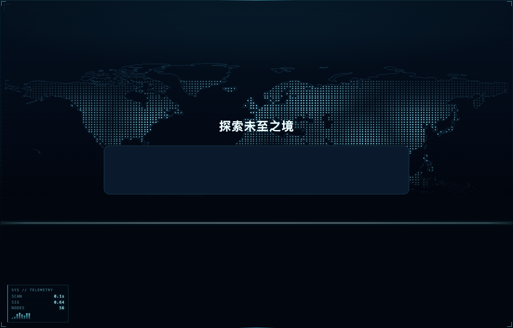
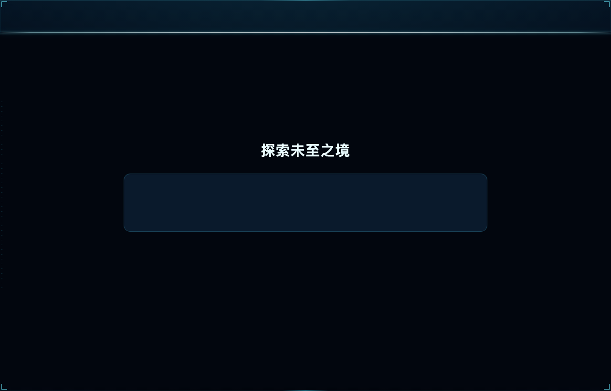
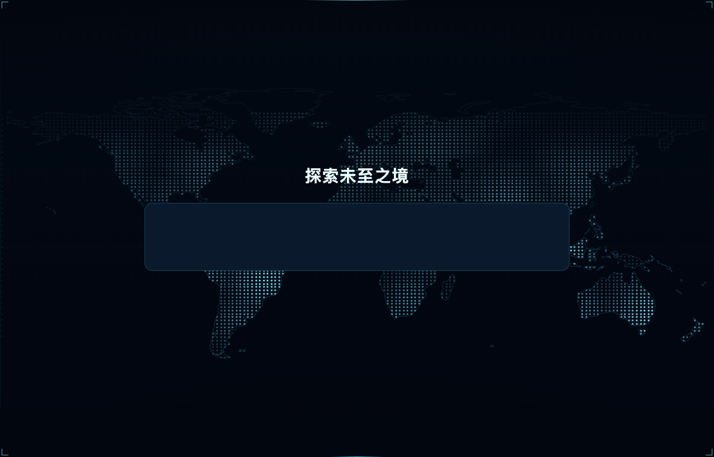
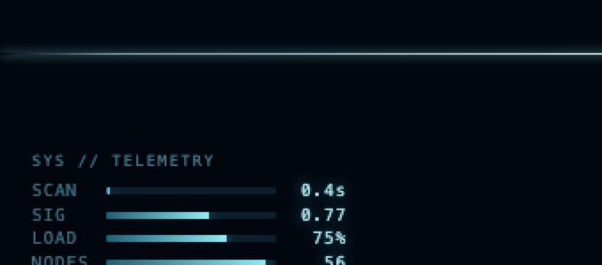
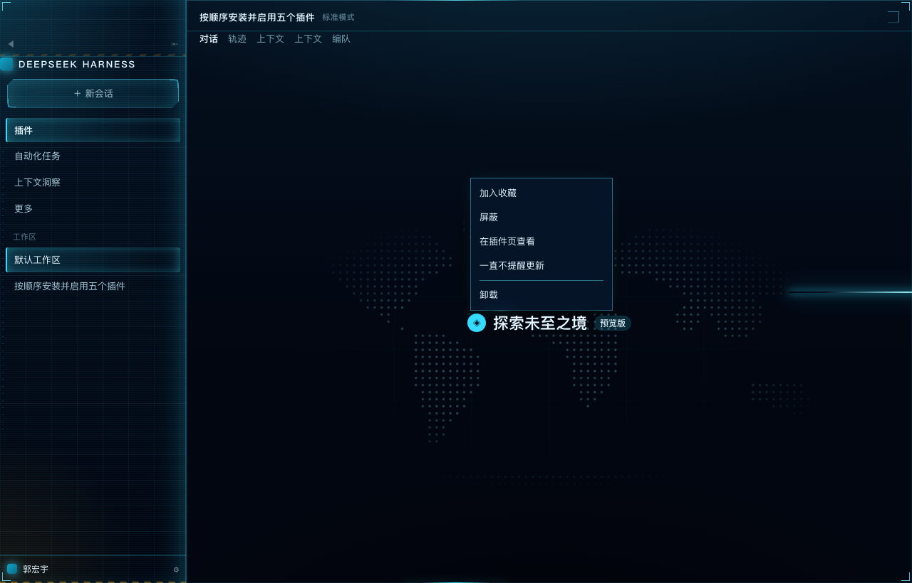

# Zero-State Radar

> 为 **DeepSeek Harness** 做的赛博朋克 HUD 皮肤：恒定夜间配色，以及空会话时才会出现的 **零态雷达扫描**。

<p align="center">
  
</p>

空会话里，一条扫描线自上而下扫过，扫过的位置浮现**点阵式真实海岸线世界地图**；城市节点与航线随后逐条绘出，左下角的数据监控在信号干扰后浮现。发出第一条消息的瞬间，这一切整体退场，不留痕迹。

全部由 CSS 动画 + 一小段原生 JS 实现，**不依赖任何图片资源**（地图是内联 SVG data URI）。

English: a cyberpunk HUD theme for DeepSeek Harness, with a *Zero-State Radar* — a radar sweep, dotted world map, network arcs and a telemetry panel that only exist while the conversation is empty. Pure CSS/SVG, no image assets.

---

## 效果

### 1. 扫描开始 —— 一束光自上而下

<p align="center">
  
</p>

线本身就是边界：**线以下是全黑**，线扫过之后地图才在 96px 的范围内渐显出来。

### 2. 地图显影 —— 真实海岸线 + 3000+ 点阵

<p align="center">
  
</p>

- 海岸线来自 Natural Earth 110m 陆地数据，栅格化成 2° 网格的圆点（4000+ 个 `<circle>`）；
- 城市化节点 58 个，其中 8 个枢纽带双环与十字准星；
- 15 条二次贝塞尔航线，带流动亮点；
- 每个元素的出现时间按纬度排延迟，所以是「扫到哪、画到哪」。

### 3. 数据监控 —— 扫描线到达左下角后才出现

<p align="center">
  
</p>

`SCAN / SIG / LOAD / NODES` 四行读数，横条式进度。扫描线扫到左下角（约 4 秒）时先播一次**信号干扰**（RGB 色散 + 逐行抖动），随后渐显，之后一直保持，直到你发出第一条消息。

干扰是**按行**做的，每行有自己的幅度和延迟，看起来像数据在跳，而不是一张图被整体晃动。

### 4. 主题本身

<p align="center">
  
</p>

恒定夜间配色（不再有白天模式）。覆盖了 114 个 `--dsw-alias-*` 与 `--dsw-specific-*` 变量，包括容易漏的菜单专用 token：

```css
--dsw-menu-surface-fill: rgba(7, 21, 37, .92);
--dsw-menu-backdrop-filter: blur(18px) saturate(150%);
```

否则浅色主题会让下拉菜单变成一块白 70% 的灰白板。

---

## 安装

```bash
# 从本地目录安装（开发时）
# 在 DSH 里执行：
plugin_manager install_bundle target=file:/绝对路径/dsh-cyberdeck
```

或从 npm（上架后）：

```bash
plugin_manager install_bundle target=dsh-cyberdeck
```

安装后重启 DSH，或刷新页面（⌘R）。

## 触发条件

零态雷达只在**空会话**（还没发消息）时存在。退出有三重保险：

| 条件 | 行为 |
|---|---|
| 找不到 `[class*="_hero"]` | 移除全部特效层 |
| DOM 出现消息节点（`_messageRow` / `_bubble` / `_turnBody` …） | 移除全部特效层 |
| 在输入框按 <kbd>Enter</kbd> 发送 | 立即移除，不等轮询 |

## 可调参数

都在 `lib/client.js` 的 `STYLE` 段里：

| 想调什么 | 位置 | 默认 |
|---|---|---|
| 扫描周期 | `RADAR_CYCLE` | `9000`（毫秒） |
| 揭开渐变宽度 | `.cyd-radar-shade` 的 `96px` | 96px |
| 消失渐变宽度 | `.cyd-radar-veil` 的 `calc(100% - 480px)` | 480px |
| 地图大小/位置 | `.cyd-radar-map` 的 `left/right/bottom/height` | 1% / 1% / 7% / 78% |
| 监控出现时刻 | `MONITOR_AT` | 周期的 44% |
| 干扰强度 | `@keyframes cyd-row-glitch` 里的 `--gx` | 0.9–2px |

## 实现要点

- **分层**：海岸线 → 点阵 → 网络（连线/节点）→ 帘子 → 扫描线 → 官方 UI 永远在最上（`z-index` 依次递增，UI 层不参与）。
- **时间基准**：相位用 `Date.now() - radarBorn` 计算，只在建层时写一次 `--cyd-phase`；每次轮询都改 `animation-delay` 会让动画被重新计时，表现为「扫描线跳动」。
- **渐变不能和元素尺寸耦合**：帘子动的是 `translateY` 且高度恒为 100%，否则 `calc(100% - 480px)` 在元素变矮时会被钳制成 0，渐变直接消失。
- **地图是 data URI**：SVG 里的 `#` 必须转义成 `%23`，否则 URI 会在 `#` 处截断，整张图不显示。

## 兼容性

- DSH `>= 0.2.0-rc.1`
- 平台：web（桌面端）
- 尊重 `prefers-reduced-motion`：关闭所有扫描/干扰动画

## 许可

MIT © 2026

---

如果这个皮肤让你每天打开 Harness 的心情好了一点，欢迎点个 ⭐。
