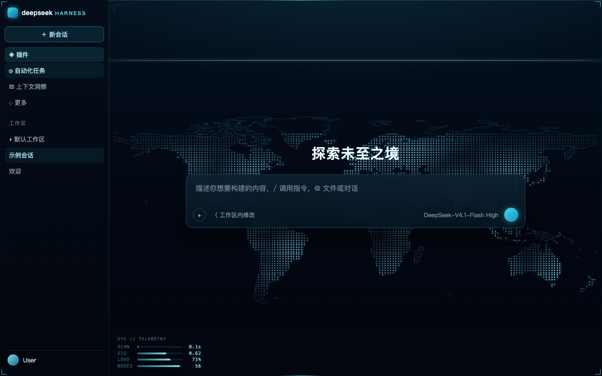
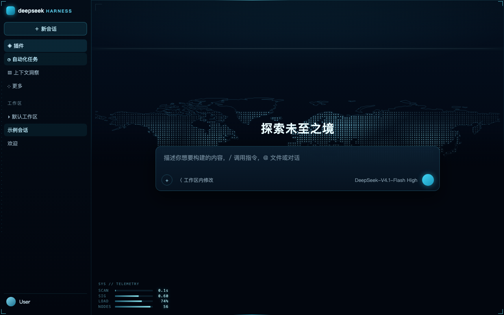

# Zero-State Radar

> 为 **DeepSeek Harness** 做的赛博朋克 HUD 皮肤：恒定夜间配色，以及空会话时才会出现的 **零态雷达扫描**。

<p align="center">
  
</p>

空会话里，一条扫描线自上而下扫过，扫过的位置浮现**点阵式真实海岸线世界地图**；城市节点与航线随后逐条绘出，左下角的数据监控在信号干扰后浮现。发出第一条消息的瞬间，这一切整体退场，不留痕迹。

全部由 CSS 动画 + 一小段原生 JS 实现，**不依赖任何图片资源**（地图是内联 SVG data URI）。

English: a cyberpunk HUD theme for DeepSeek Harness, with a *Zero-State Radar* — a radar sweep, dotted world map, network arcs and a telemetry panel that only exist while the conversation is empty. Pure CSS/SVG, no image assets.

---

## 效果

### 1. 新会话 —— 扫描线自上而下

<p align="center">
  
</p>

线本身就是边界：**线以下是全黑**，线扫过之后地图才在 96px 的范围内渐显出来。

### 2. 地图显影 —— 真实海岸线 + 3000+ 点阵

- 海岸线来自 Natural Earth 110m 陆地数据，栅格化成 2° 网格的圆点（4000+ 个 `<circle>`）；
- 城市化节点 58 个，其中 8 个枢纽带双环与十字准星；
- 15 条二次贝塞尔航线，带流动亮点；
- 每个元素的出现时间按纬度排延迟，所以是「扫到哪、画到哪」。

### 3. 数据监控 —— 扫描线到达左下角后才出现

`SCAN / SIG / LOAD / NODES` 四行读数，横条式进度。扫描线扫到左下角（约 4 秒）时先播一次**信号干扰**（RGB 色散 + 逐行抖动），随后渐显，之后一直保持，直到你发出第一条消息。

干扰是**按行**做的，每行有自己的幅度和延迟，看起来像数据在跳，而不是一张图被整体晃动。

### 4. 主题本身

恒定夜间配色（不再有白天模式）。覆盖了 114 个 `--dsw-alias-*` 与 `--dsw-specific-*` 变量，包括容易漏的菜单专用 token：

```css
--dsw-menu-surface-fill: rgba(7, 21, 37, .92);
--dsw-menu-backdrop-filter: blur(18px) saturate(150%);
```

否则浅色主题会让下拉菜单变成一块白 70% 的灰白板。

### 5. 文件卡片

对话里的文件展示也跟随主题：本轮「已编辑 N 个文件」清单、交付文件卡片（`.md` / 图片 / 代码 / PDF / 表格……）、用户消息里的附件卡片，都是深蓝面板 + 青色描边，文件类型图标统一走主题色并带轻微霓虹，不再出现白底白图标的刺眼块。

> 这些组件的浅色底来自 `--dsw-static-neutral-*`（不是 alias token）。应用处于浅色主题、皮肤处于夜晚模式时它们不跟随深色 token，会露白；本皮肤用组件自带的数据属性（`[data-changed-files]` / `[data-presented-file]`）定位并覆盖，类名哈希随版本变化也不受影响。

---

## 安装

本插件是一个 DSH bundle：`package.json` 里声明了 `dsh.bundle.patch`（宿主侧空壳）
和 `dsh.client`（web 客户端）。装进 profile 就是两件事：加一条依赖、把包名加进
`dsh.profile.bundles`。DSH 的 `plugin_manager`（`action: install_bundle`）一次做完。

### 方式 1：从本地目录安装（推荐，离线可用）

`target` 是**本仓库根目录的绝对路径**（`file:` / `link:` 前缀也可以，但后面必须
跟绝对路径）：

```bash
plugin_manager install_bundle target=C:\Users\你\Downloads\zero-state-radar
```

等价命令行：

```bash
dsh plugin --profile desktop add C:\Users\你\Downloads\zero-state-radar
```

这是 `link:` 安装：profile 里的 `node_modules/dsh-cyberdeck` 指向这个目录，改完
`lib/client.js` 刷新页面（<kbd>Ctrl</kbd>+<kbd>R</kbd> / <kbd>⌘</kbd>+<kbd>R</kbd>）
就生效，不用重装。

### 方式 2：从 GitHub Release 装预构建包

```bash
plugin_manager install_bundle target=https://github.com/Gsaecy/Zero-State-Radar/releases/latest/download/dsh-cyberdeck.tgz
```

> **大陆网络注意**：这个链接最终跳到 `release-assets.githubusercontent.com`，
> 该域名常被解析成 `127.0.0.1`，pnpm 就会报
> `[ERROR] fetch failed` / `ECONNREFUSED ...release-assets.githubusercontent.com`。
> 这是下载链路的问题，不是插件本身的问题。三条路任选：
>
> - 让 pnpm 走代理再装：在 `~/.npmrc` 里写 `proxy=` / `https-proxy=`，或设置
>   `HTTP_PROXY` / `HTTPS_PROXY` 环境变量。注意 pnpm **不读** git 的
>   `http.proxy` 配置，所以只配了 `git config` 的话照样会失败。
> - 或者用方式 1 从本地目录装，完全不联网。
> - 或者给 Release 链接加第三方 GitHub 代理前缀（镜像会改写下载来源，自行评估）：
>
>   ```bash
>   plugin_manager install_bundle target=https://gh-proxy.com/https://github.com/Gsaecy/Zero-State-Radar/releases/latest/download/dsh-cyberdeck.tgz
>   ```
>
>   Release 附件由 CI 在打 tag 时重新打包，哈希会随构建变化；要校验就取
>   `GET /repos/Gsaecy/Zero-State-Radar/releases/latest` 返回里该附件的
>   `assets[].digest`（`sha256:…`）与下载到的文件比对。
>
> 插件市场里的一键安装走的也是同一条 Release 链接，受同一个网络问题影响。

### 安装之后

- 客户端 bundle 在页面刷新后加载；若宿主侧条目未生效，重启一次 DSH。
- 临时关掉皮肤：<kbd>Ctrl</kbd>+<kbd>Alt</kbd>+<kbd>K</kbd>，或控制台
  `__cyberdeck.off()`。

### 升级 / 重装（Windows 注意）

市场是「先卸载、再安装」。DSH 正在运行时，旧包的文件可能还被占用，pnpm 在 Windows
上会报 `ERR_PNPM_EPERM`（`rename ... -> node_modules\dsh-cyberdeck`），市场里就显示
「无法安装」。稳妥顺序：

1. **完全退出 DeepSeek Harness**（不是刷新页面）；
2. 重新打开后，再在市场里点安装 / 更新。

如果之前用本地目录（`link:`）装过，卸载后 `node_modules\dsh-cyberdeck` 可能留下一个
指向旧目录的 junction，会挡住下次安装（同样报 EPERM）。把那个 junction 删掉再装即可
（只删链接，不会动你的工作区），或者干脆按上面顺序先退出再操作。

Linux / macOS 没有这个 Windows 文件占用问题，但「先退出再更新」仍然最稳。

### 发布新版本

1. 改 `package.json` 的 `version`，在 [CHANGELOG.md](CHANGELOG.md) 记一笔，提交并推送；
2. 打 tag 并推送，CI 会自动打包并发 Release：

```bash
git tag -a v0.1.3 -m "Zero-State Radar v0.1.3"
git push origin v0.1.3
```

[`.github/workflows/release.yml`](.github/workflows/release.yml) 会：校验 tag 与
`package.json` 版本一致 → `npm pack` → 把产物改名成 `dsh-cyberdeck.tgz` →
创建/更新对应 tag 的 Release 并上传附件。

- 想自定义 Release 说明，放一个 `release-notes/v0.1.3.md`（没有则用 GitHub 自动生成的变更说明）；
- 想修某个已发布版本的附件、或补发说明：Actions → **release** → **Run workflow**，
  填上已有 tag（如 `v0.1.2`）；Release 已存在时只覆盖附件，不会新建 Release；
- 手动发布也可以：`npm pack` → 产物改名成 `dsh-cyberdeck.tgz` 上传到 Release。
  安装 URL 依赖这个固定附件名（`releases/latest/download/dsh-cyberdeck.tgz`）；
- tarball 必须是 `npm pack` 产物（根目录为 `package/`），否则 pnpm 装不上。

### 发 npm（可选，但推荐）

插件市场的安装优先级是 **npm 包 > GitHub Release tarball > 整仓源码**。发 npm 后，
市场会优先走 registry 安装——大陆网络访问 `registry.npmjs.org`（以及 npmmirror 等
fallback）比访问 `release-assets.githubusercontent.com` 稳得多。

1. 在 npm 建一个 **Automation token**；
2. 仓库 Settings → Secrets and variables → Actions 添加 Secret `NPM_TOKEN`；
3. 之后再打 tag 时，workflow 的 `npm-publish` job 会 `npm publish --access public`
   （版本已存在会自动跳过；没配 `NPM_TOKEN` 时该 job 只打印跳过，不影响 Release）；
4. 也可以不依赖 CI，本地 `npm publish` 一次即可。

> npm 包名是 `dsh-cyberdeck`（`package.json` 的 `name`）；`repository` 字段指回本仓库，
> 市场据此把 npm 包和 GitHub 条目对上。收录列表（awesome-dsh-plugin）里的 `npm`
> 字段是那边采集刷新后才更新的。

## 触发条件

零态雷达只在**空会话**（还没发消息）时存在。退出有三重保险：

| 条件 | 行为 |
|---|---|
| 找不到 `[class*="_hero"]` | 移除全部特效层 |
| DOM 出现消息节点（`_messageRow` / `_bubble` / `_turnBody` …） | 移除全部特效层 |
| 在输入框按 <kbd>Enter</kbd> 发送 | 立即移除，不等轮询 |

## 可调参数

都在 `lib/client.js` 的 `STYLE` 段里：

| 想调什么 | 位置 | 默认 |
|---|---|---|
| 扫描周期 | `RADAR_CYCLE` | `9000`（毫秒） |
| 揭开渐变宽度 | `.cyd-radar-shade` 的 `96px` | 96px |
| 消失渐变宽度 | `.cyd-radar-veil` 的 `calc(100% - 480px)` | 480px |
| 地图大小/位置 | `.cyd-radar-map` 的 `left/right/bottom/height` | 1% / 1% / 7% / 78% |
| 监控出现时刻 | `MONITOR_AT` | 周期的 44% |
| 干扰强度 | `@keyframes cyd-row-glitch` 里的 `--gx` | 0.9–2px |

## 实现要点

- **分层**：海岸线 → 点阵 → 网络（连线/节点）→ 帘子 → 扫描线 → 官方 UI 永远在最上（`z-index` 依次递增，UI 层不参与）。
- **时间基准**：相位用 `Date.now() - radarBorn` 计算，只在建层时写一次 `--cyd-phase`；每次轮询都改 `animation-delay` 会让动画被重新计时，表现为「扫描线跳动」。
- **渐变不能和元素尺寸耦合**：帘子动的是 `translateY` 且高度恒为 100%，否则 `calc(100% - 480px)` 在元素变矮时会被钳制成 0，渐变直接消失。
- **地图是 data URI**：SVG 里的 `#` 必须转义成 `%23`，否则 URI 会在 `#` 处截断，整张图不显示。

## 兼容性

- DSH `>= 0.2.0-rc.1`
- 平台：web（桌面端）
- 尊重 `prefers-reduced-motion`：关闭所有扫描/干扰动画

## 许可

MIT © 2026

---

如果这个皮肤让你每天打开 Harness 的心情好了一点，欢迎点个 ⭐。
